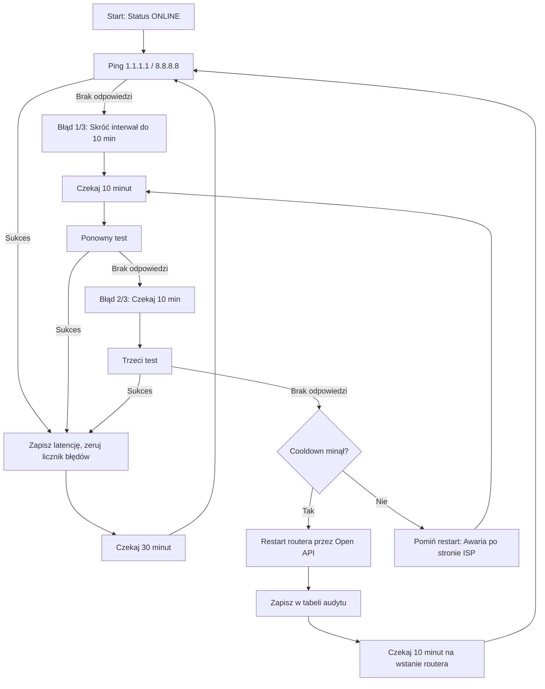

# 🛡️ Omada ER605 Watchdog LXC (Proxmox VE)

Kompletne, bezobsługowe rozwiązanie watchdoga sieciowego uruchamiane w dedykowanym, ultralekkim kontenerze Debian 12 LXC na platformie **Proxmox Virtual Environment (PVE 7 / 8 / 9)**.

Narzędzie stale monitoruje łączność ze światem zewnętrznym i w przypadku wykrycia trwałej awarii łącza automatycznie inicjuje restart routera **TP-Link Omada ER605** za pośrednictwem oficjalnego **Omada SDN Open API v1**. Posiada wbudowany webowy interfejs w stylu Matrix/Cyberpunk z wykresem 24h, audytem restartów w czasie rzeczywistym oraz gotowymi endpointami pod Home Assistanta.

---

## 📑 Spis treści
1. [Główne funkcje](#-główne-funkcje)
2. [Logika działania watchdoga](#-logika-działania-watchdoga)
3. [Wymagania wstępne w Omada Controller](#-wymagania-wstępne-w-omada-controller)
4. [Instalacja (Host Proxmox VE)](#-instalacja-host-proxmox-ve)
5. [Aktualizacja (Update)](#-aktualizacja-update)
6. [Zarządzanie usługą w shellu](#-zarządzanie-usługą-w-shellu)
7. [Opis funkcji panelu Web UI](#-opis-funkcji-panelu-web-ui)
8. [Integracja z Home Assistant](#-integracja-z-home-assistant)
9. [Struktura plików w kontenerze](#-struktura-plików-w-kontenerze)
10. [Parametry konfiguracyjne (config.json)](#-parametry-konfiguracyjne-configjson)
11. [Architektura API Omady](#-architektura-api-omady)
12. [Rozwiązywanie problemów (Troubleshooting)](#-rozwiązywanie-problemów-troubleshooting)
13. [Bezpieczeństwo](#-bezpieczeństwo)
14. [Licencja](#-licencja)

---

## 🚀 Główne funkcje
- **Automatyczny watchdog ICMP**: Cykliczne testowanie łączności z niezależnymi publicznymi węzłami Anycast (`1.1.1.1` Cloudflare, `8.8.8.8` Google).
- **Adaptacyjne interwały sprawdzania**:
  - Stan `ONLINE`: sprawdzanie co **30 minut**.
  - Wykrycie `OFFLINE`: natychmiastowe skrócenie interwału do **10 minut**.
- **Potrójna weryfikacja (Debounce)**: Restart następuje dopiero po 3 kolejnych nieudanych próbach w interwale 10-minutowym, co eliminuje fałszywe restarty przy chwilowych fluktuacjach łącza.
- **Zabezpieczenie Cooldown**: Konfigurowalna blokada czasowa (domyślnie 3 godziny) uniemożliwiająca wejście routera w niekończącą się pętlę restartów (*boot loop*), gdy awaria leży po stronie operatora (ISP).
- **Oficjalne Omada SDN Open API v1**: Wykorzystanie bezpiecznego mechanizmu OAuth 2.0 (`client_credentials`) oraz bezpośredniego endpointu `/devices/{mac}/reboot`.
- **Weryfikacja Pre-flight podczas instalacji**: Instalator testuje połączenie z kontrolerem, pobiera witryny (*sites*) i weryfikuje obecność routera po adresie MAC jeszcze przed utworzeniem kontenera.
- **Cyberpunk / Matrix Web UI**: Lekki, responsywny panel WWW oparty na czystym HTML/CSS/JS (brak ciężkich frameworków, zerowy narzut pamięciowy):
  - Dynamiczny status WAN na żywo i licznik błędów.
  - Pomiar latencji ping w milisekundach.
  - Wykres słupkowy historii pomiarów z ostatnich 24 godzin.
  - Tabela **REBOOT_HISTORY & AUDIT_LOG** (czas, trigger, kod HTTP/API, szczegółowa odpowiedź JSON kontrolera).
  - Manualne przyciski natychmiastowego testu połączenia oraz wymuszenia restartu routera.
  - Interaktywne tło reagujące na ruch kursora myszy (*radial gradient glow*).
- **Integracja Home Assistant**: Wbudowane endpointy `/api/status` oraz `/api/state` pozwalają na odpytywanie stanu i pobieranie danych jako encje HA.
- **Minimalny narzut**: Kontener zużywa zaledwie ~30-40 MB pamięci RAM.

---

## ⚙️ Logika działania watchdoga



1. Standardowy test łączności wykonuje się co **30 minut**.
2. W razie braku odpowiedzi zegar przełącza się na tryb awaryjny: ponowienie po **10 minutach**.
3. Jeśli po **3 próbach** (po ok. 20 minutach od pierwszej awarii) łącze nadal nie działa, następuje sprawdzenie cooldownu.
4. Gdy cooldown jest nieaktywny, watchdog wysyła żądanie restartu do Omada Controller, resetuje licznik cooldownu i zapisuje odpowiedź do historii.
5. Kolejna próba weryfikacji odbywa się po **10 minutach**.

---

## 📋 Wymagania wstępne w Omada Controller
1. Zaloguj się do lokalnego kontrolera **Omada SDN Controller** (np. `https://192.168.0.4:443`).
2. Przejdź do: **Global View** ➔ **Settings** ➔ **Open API**.
3. Włącz przełącznik **Open API**.
4. W sekcji **Attributes** odczytaj i skopiuj:
   - **Interface Access Address**: URL dostępu do API kontrolera (np. `https://192.168.0.4`).
   - **Omada ID**: 32-znakowy ciąg hex (np. `f96897b03e1cfbfde177edb61dfb1b2c`).
5. W sekcji aplikacji Open API utwórz nową aplikację i wygeneruj:
   - **Client ID**
   - **Client Secret**
6. Sprawdź adres **MAC** routera ER605 w zakładce *Devices* (np. `B8-FB-B3-2D-B4-5E`).

---

## 📥 Instalacja (Host Proxmox VE)

Zaloguj się przez SSH do hosta **Proxmox VE** lub otwórz konsolę `Shell` w panelu webowym PVE i uruchom:

```bash
bash -c "$(curl -fsSL https://raw.githubusercontent.com/devv0lf/omada-watchdog/main/install.sh)"
```

Kreator instalacji zapyta o:
- ID kontenera LXC (np. `107`),
- Dane dostępowe Open API (URL, Omada ID, Client ID, Client Secret),
- Adres MAC routera ER605,
- Czas trwania cooldownu po restarcie (domyślnie 3h).

Po zakończeniu skrypt wyświetli adres IP i port (`:8080`), pod którym dostępny jest panel WWW.

---

## 🔄 Aktualizacja (Update)

Aktualizacja pobiera najnowszą wersję kodu aplikacji (`app.py`), **nie naruszając Twojego pliku konfiguracyjnego `config.json`** z zapisanymi kluczami API, po czym automatycznie restartuje usługę.

### Sposób 1: Bezpośrednio w shellu kontenera LXC
Otwórz konsolę kontenera w panelu Proxmox (**LXC ➔ Console**) lub połącz się z kontenerem przez SSH i wklej:

```bash
bash -c "$(curl -fsSL https://raw.githubusercontent.com/devv0lf/omada-watchdog/main/update.sh)"
```

### Sposób 2: Z poziomu shella hosta Proxmox VE
Jeśli wolisz zaktualizować kontener z konsoli głównej Proxmoxa bez logowania się do kontenera (zamień `107` na ID swojego kontenera):

```bash
pct exec 107 -- bash -c "$(curl -fsSL https://raw.githubusercontent.com/devv0lf/omada-watchdog/main/update.sh)"
```

---

## 💻 Zarządzanie usługą w shellu

### Komendy w shellu kontenera LXC:

```bash
Sprawdzenie bieżącego statusu usługi
systemctl status omada-watchdog.service

Podgląd logów w czasie rzeczywistym
journalctl -u omada-watchdog.service -f

Wyświetlenie ostatnich 50 linii logów
journalctl -u omada-watchdog.service -n 50 --no-pager

Restart usługi
systemctl restart omada-watchdog.service

Zatrzymanie usługi
systemctl stop omada-watchdog.service

Uruchomienie usługi
systemctl start omada-watchdog.service
```

### Komendy z poziomu shella hosta Proxmox VE:

*(Dla kontenera o ID `107`)*

```bash
Sprawdzenie statusu usługi
pct exec 107 -- systemctl status omada-watchdog.service

Podgląd logów
pct exec 107 -- journalctl -u omada-watchdog.service -n 50 --no-pager

Restart usługi
pct exec 107 -- systemctl restart omada-watchdog.service

Sprawdzenie adresu IP kontenera
pct exec 107 -- ip -br a
```

---

## 🖥️ Opis funkcji panelu Web UI

Panel dostępny jest pod adresem `http://<IP_KONTENERA>:8080`:

- **SYSTEM METRICS**: Bieżący status WAN (`ONLINE` na zielono, `OFFLINE` na czerwono), zmierzona latencja ICMP, licznik kolejnych błędów oraz data i godzina ostatniego restartu.
- **HISTORY & LATENCY (24H)**: Oś czasu z historią pomiarów i słupkami latencji.
- **REBOOT_HISTORY & AUDIT_LOG**: Tabela rejestrująca każde zdarzenie restartu (zarówno automatyczne z watchdoga, jak i manualne z przycisku), zawierająca timestamp, trigger, kod odpowiedzi HTTP oraz odpowiedź JSON kontrolera.
- **MANUAL CONTROLS**:
  - `TEST CONNECTIVITY NOW` – wymusza natychmiastowe wykonanie testu ICMP bez czekania na upływ interwału.
  - `FORCE REBOOT ROUTER` – bezpieczny manualny restart routera z monitem potwierdzenia.

---

## 🏠 Integracja z Home Assistant

Watchdog udostępnia lekki endpoint JSON pod adresem `http://<IP_KONTENERA>:8080/api/status`.

### Konfiguracja w `configuration.yaml`:

```yaml
sensor:
  - platform: rest
    name: "Omada Watchdog"
    resource: "http://192.168.0.33:8080/api/status"
    scan_interval: 30
    json_attributes:
      - status
      - latency_ms
      - consecutive_failures
      - last_check
      - last_reboot
      - cooldown_hours
    value_template: "{{ value_json.status }}"

  - platform: template
    sensors:
      omada_wan_latency:
        friendly_name: "WAN Latency"
        unit_of_measurement: "ms"
        value_template: "{{ state_attr('sensor.omada_watchdog', 'latency_ms') }}"
      omada_failures_count:
        friendly_name: "Failures Count"
        value_template: "{{ state_attr('sensor.omada_watchdog', 'consecutive_failures') }}"
```

---

## 📁 Struktura plików w kontenerze

Wszystkie pliki aplikacji znajdują się w katalogu `/opt/omada-watchdog/`:

```text
/opt/omada-watchdog/
├── app.py           # Serwer HTTP, logika watchdoga i obsługa Open API
├── config.json      # Konfiguracja (URL, Omada ID, klucze, MAC, interwały) [chmod 0600]
└── state.json       # Trwały stan, historia pomiarów 24h oraz tabela audytu
```

Plik jednostki systemd: `/etc/systemd/system/omada-watchdog.service`.

---

## ⚙️ Parametry konfiguracyjne (config.json)

Plik `/opt/omada-watchdog/config.json` tworzony jest automatycznie podczas instalacji:

```json
{
  "omada_url": "https://192.168.0.4",
  "omadac_id": "f96897b03e1cfbfde177edb61dfb1b2c",
  "client_id": "twoj_client_id",
  "client_secret": "twoj_client_secret",
  "target_mac": "B8-FB-B3-2D-B4-5E",
  "site_id": "698cbfa284806d1d204161b9",
  "site_name": "dom",
  "web_port": 8080,
  "cooldown_hours": 3,
  "check_interval_minutes": 30,
  "retry_interval_minutes": 10,
  "max_retries": 3,
  "ping_targets": ["1.1.1.1", "8.8.8.8"]
}
```

Aby zmienić parametry ręcznie w shellu kontenera:
```bash
nano /opt/omada-watchdog/config.json
systemctl restart omada-watchdog.service
```

---

## 📡 Architektura API Omady

Watchdog komunikuje się z kontrolerem za pomocą dwóch zapytań REST:

1. **Pobranie tokena dostępowego (OAuth 2.0)**:
   - `POST /openapi/authorize/token?grant_type=client_credentials`
   - Nagłówek: `Content-Type: application/json`
   - Body:
```json
     {
       "omadacId": "f96897b03e1cfbfde177edb61dfb1b2c",
       "client_id": "...",
       "client_secret": "..."
     }
```

2. **Wywołanie restartu urządzenia**:
   - `POST /openapi/v1/{omadac_id}/sites/{site_id}/devices/{mac}/reboot`
   - Nagłówek: `Authorization: AccessToken=<token>`
   - Format MAC: myślniki, wielkie litery (np. `B8-FB-B3-2D-B4-5E`)

---

## 🔧 Rozwiązywanie problemów (Troubleshooting)

### 1. Błąd HTTP 401 Unauthorized przy restarcie
Upewnij się, że nagłówek autoryzacji w zapytaniu do Open API ma postać `Authorization: AccessToken=<token>` (nie `Bearer` ani sam `AccessToken:`).

### 2. Panel Web UI nie odpowiada (ERR_CONNECTION_REFUSED)
Sprawdź, czy usługa działa w kontenerze:
```bash
systemctl status omada-watchdog.service
```
Jeśli usługa zgłasza błąd składni, zaktualizuj aplikację do najnowszej wersji zgodnej z Pythonem 3.11:
```bash
bash -c "$(curl -fsSL https://raw.githubusercontent.com/devv0lf/omada-watchdog/main/update.sh)"
```

### 3. Zła godzina w logach / na wykresie
Jeśli wpisy w panelu są przesunięte o np. 2 godziny, zsynchronizuj strefę czasową kontenera:
```bash
timedatectl set-timezone Europe/Warsaw
systemctl restart omada-watchdog.service
```

---

## 🔒 Bezpieczeństwo
- Plik `config.json` posiada uprawnienia `0600` (odczyt i zapis wyłącznie dla użytkownika `root`).
- Komunikacja z kontrolerem odbywa się po protokole HTTPS.
- Kontener LXC działa w izolowanym środowisku i nasłuchuje wyłącznie na wybranym porcie Web UI.
- Nigdy nie publikuj swojego pliku `config.json` ani prawdziwych poświadczeń API w publicznym repozytorium git.

---

## 📄 Licencja
Projekt udostępniany na licencji **MIT**. Szczegóły w pliku `LICENSE`.
